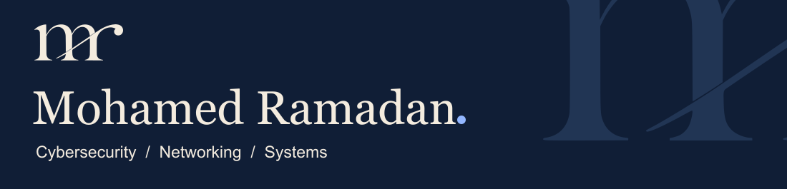

  

I’m Mohamed Ramadan, based in Cairo. I build networking and defensive security labs, work with Linux and Windows Server, and write Python tools to make configuration issues easier to spot.

## Selected work

[**HeaderHound**](https://github.com/m-ramadan-sec/headerhound) is my Python CLI for reviewing HTTP security headers. It checks a URL and its redirects, then reports its findings in the terminal or as JSON.

[**Network and systems labs**](https://www.moramadan.com/#work) cover routed networks in Cisco Packet Tracer and Windows Server hardening with Active Directory and Group Policy.

## Networking coursework

**Cisco Networking Academy** · [Introduction to Networks](https://www.credly.com/badges/dc586e19-ab30-4449-a912-4d45cfbb6fe9/public_url) · [Switching, Routing & Wireless Essentials](https://www.credly.com/badges/ae9e013d-9dcd-409d-b6a3-412f27a59b18/public_url) · [Enterprise Networking, Security & Automation](https://www.credly.com/badges/54884140-afb2-494d-9621-7c645691a31e/public_url)

## Contact

[Portfolio](https://www.moramadan.com/) · [LinkedIn](https://www.linkedin.com/in/eng-mohamed-ramadan-cyber) · [hello@moramadan.com](mailto:hello@moramadan.com)
